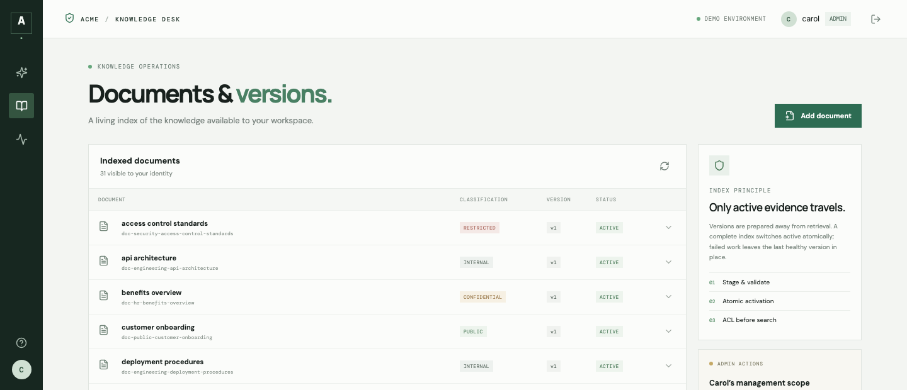
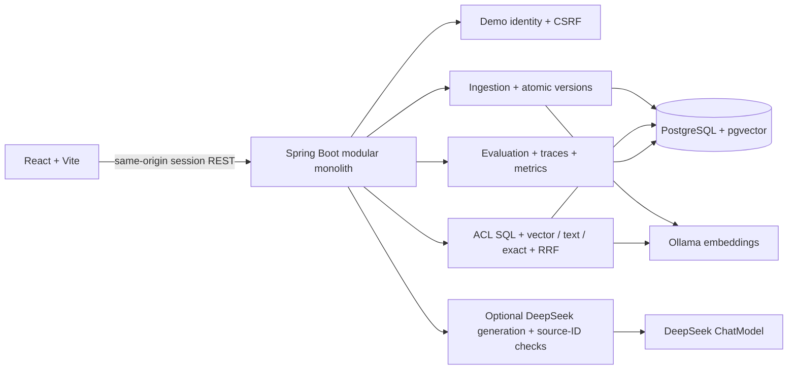

# Enterprise RAG Assistant

[](https://github.com/chen3862000-coder/enterprise-rag-assistant/actions/workflows/verify.yml)

**Enterprise knowledge. Authorized retrieval. Inspectable sources.**

A portfolio MVP showing document-level authorization, active document versions, hybrid retrieval, source-authorized citations, deterministic evidence sufficiency, offline evaluation, and safe bounded traces. Citation IDs are source references, not claim-level verification. It demonstrates architecture patterns; it is **not a production-ready SaaS service**.

All Acme Enterprise documents are synthetic and safe to publish.



## What Is Implemented

- Markdown, text, and extractable-PDF ingestion; scanned PDFs/OCR are unsupported.
- Local Ollama embeddings with `nomic-embed-text` and PostgreSQL/pgvector persistence.
- Optional DeepSeek-backed answer generation, configured independently from embeddings.
- ACL-constrained vector, PostgreSQL full-text, and exact-identifier retrieval, fused with RRF.
- Server-issued demo sessions, role-scoped SQL retrieval, authorized source previews, and citations.
- Staged version indexing with transactionally activated chunks and version permissions.
- Explicit restore for disabled/deleted documents; uploads cannot silently reactivate an inactive logical document.
- A 63-scenario deterministic offline evaluation (dataset v5, including additional adversarial and permission-scope cases). It measures retrieval, ACL, freshness, citation-ID validation, and the shared evidence-sufficiency gate; it does not measure generated-answer correctness.
- Bounded RAG traces, role-scoped trace APIs, 30-day default retention, and low-cardinality metrics.
- React chat, knowledge-management, and evaluation workspaces.

## Architecture



More detail is in [`docs/architecture.md`](docs/architecture.md), the [DDD system design](docs/ddd-system-design.md), [`docs/security-design.md`](docs/security-design.md), [`docs/retrieval-design.md`](docs/retrieval-design.md), and [`docs/evaluation-design.md`](docs/evaluation-design.md).

## Quick Start

Requirements: Docker Desktop with Compose, a supported JDK 21 for local Java checks, and a DeepSeek API key to generate answers. The first startup downloads the Ollama image/model and may take several minutes.

```bash
cp .env.example .env
# Edit .env and set DEEPSEEK_API_KEY for generated answers.
docker compose up --build -d
```

Open `http://localhost:3000`. The Compose stack runs PostgreSQL/pgvector, Ollama, one-time embedding-model setup, the Spring backend, and the React/Nginx frontend. Synthetic docs seed at backend startup. Ollama pulls `${EMBEDDING_MODEL:-nomic-embed-text}` into its persistent volume.

The app login is a demo identity selector, not password authentication. Compose defaults `CHAT_MODEL_PROVIDER=none`, so it starts without paid credentials; chat still runs retrieval and the evidence gate, but generated prose is disabled. Set `DEEPSEEK_API_KEY` and `CHAT_MODEL_PROVIDER=deepseek` in `.env` to enable generation. Offline evaluation and tests do not require the key.

### Local Backend Development

With PostgreSQL and Ollama available at the configured URLs:

```bash
cd backend
./mvnw spring-boot:run
```

The default seed path is `../synthetic-docs`; set `APP_SEED_ENABLED=true` and `APP_SEED_PATH` as needed. Pull the local embedding model once with `ollama pull nomic-embed-text` if Ollama does not already have it.

## Developer Commands

| Command | Purpose |
|---|---|
| `make up` | Build and start the Compose stack |
| `make down` | Stop the stack (preserves named volumes) |
| `make logs` | Follow service logs |
| `make seed` | Start/rebuild the backend with startup seeding enabled |
| `make test` | Run backend tests, Testcontainers, analysis, and coverage gates |
| `make frontend-test` | Run React component tests |
| `make eval` | Sign in as Carol and run the offline 63-scenario suite (requires `jq`) |

Backend quality gate, on Java 21:

```bash
cd backend && ./mvnw verify
```

This runs unit tests, PostgreSQL/pgvector Testcontainers integration tests, PMD, SpotBugs, ArchUnit, and JaCoCo class/method coverage thresholds. JaCoCo reports are written under `backend/target/site/jacoco/`. Frontend checks:

```bash
cd frontend && npm ci && npm run build && npm test -- --run && npm audit --audit-level=moderate
```

## Demo Identities

| Identity | Retrieval roles | Management/evaluation |
|---|---|---|
| Alice | Public, Engineering | No |
| Bob | Public, HR | No |
| Carol | Public, Security | Explicit document admin |

Carol’s document-management capability is separate from her retrieval scope. She can manage document metadata and evaluations, but only public/security evidence is eligible for her chat. Changing client-side role fields cannot grant access.

## Demo Scenarios

1. **Authorized evidence retrieval:** ask “What is the Enterprise API rate limit, and how should clients handle HTTP 429?” Inspect the gate reason, source references, and trace. Source IDs do not prove factual entailment.
2. **Permission isolation:** compare Alice and Bob on an HR-only policy. Alice should not receive HR evidence; direct source resolution independently applies access checks.
3. **Freshness/evaluation:** sign in as Carol, upload a newer policy under its logical document ID, then query again and run the offline evaluation. Inspect the active version and actual persisted results.

## API Overview

- `GET /api/auth/csrf`, `POST /api/auth/login`, `GET /api/auth/me`, `POST /api/auth/logout`
- `POST /api/chat`
- `GET /api/sources/{chunkId}`
- `GET /api/documents`, `POST /api/documents`, `POST /api/documents/{id}/reindex`, `GET /api/documents/{id}/versions`, `POST /api/documents/{id}/disable`, `POST /api/documents/{id}/restore`, `DELETE /api/documents/{id}` (soft delete)
- `POST /api/evaluations/run`, `GET /api/evaluations`, `GET /api/evaluations/{runId}`
- `GET /api/traces/{traceId}`

Mutating browser requests require the session CSRF token. Document mutation and evaluation endpoints require Carol’s explicit admin capability. Ordinary document list/version metadata is role filtered; trace detail is owner/admin scoped.

Example chat request after login:

```json
{"message":"What is the Enterprise API rate limit?"}
```

Example response fields include `answer`, resolvable `citations`, `traceId`, and `groundingStatus`. `CITATIONS_PRESENT` means authorized source IDs were attached; it does not mean claims were independently verified. The deterministic evidence gate returns `INSUFFICIENT_EVIDENCE` and no citations for weak/unsupported evidence.

## Evaluation and Observability

The offline dataset version is `2026-10-p1-v5` (63 scenarios; the original 56 labels are unchanged and seven adversarial/scope cases are added). Offline results use retrieval only and do not call DeepSeek. Recall@5/MRR report retrieval relevance; ACL leakage, freshness, citation-ID validation, false-abstention and false-admission rates are separate checks. Per-scenario diagnostics show vector score, OR lexical score, and meaningful query-term coverage. Release quality requires zero ACL leakage, at least 10 relevant-positive and 10 negative cases, false abstention ≤20%, and false admission ≤5%. The latest local persisted run (`84bf669d-8fe2-468c-8bc4-46d23198e8e5`) passed: Recall@5 1.000, MRR 0.912, ACL leakage 0, freshness 1.000, citation-ID validation 1.000, gate accuracy 0.968, false abstention 5.7%, and false admission 0.0%. Two positive cases (`rag-020`, `rag-028`) remain false-abstained; no negative case was admitted. Compared with the preceding v5 run, rollback-phrase normalization resolved `rag-051`. This is a synthetic-corpus retrieval/gate result, not generated-answer correctness or faithfulness.

Traces store a query hash and bounded timing/count/provider/status fields, not raw queries or retrieved text. Trace retention defaults to 30 days. Micrometer metrics avoid user/document/query labels. Chat persistence of a trace is best-effort so a telemetry write issue does not replace a successful answer with a failed request.

## Verification Status

Verification last run locally on 2026-10-26; these outcomes describe the checked worktree only, not a permanent guarantee. Backend: `cd backend && ./mvnw clean verify` on Java 21 passed (59 unit tests, 32 Testcontainers PostgreSQL/pgvector integration tests, PMD, SpotBugs, ArchUnit, and JaCoCo thresholds). Frontend: `cd frontend && npm ci && npm run build && npm test -- --run && npm audit --audit-level=moderate` passed (5 tests, zero audit findings). Browser workflows: `cd frontend && npm run test:e2e` passed (3 Playwright workflows) with cold Compose startup and verified teardown. Deployment checks: `docker compose config --quiet`, `docker compose build backend frontend`, and Compose health checks passed; Flyway applied through V11 without removing volumes. The GitHub Actions `Verify` workflow has been added locally and will run these backend, frontend, browser, and Compose checks on pull requests and pushes to `main` after this change is pushed.

Earlier Compose measurements are historical. Run the current suite with `make eval` and report its persisted results. It measures retrieval/evidence-gate behavior, not generated-answer quality.

Playwright browser workflows run with `cd frontend && npm run test:e2e`. The checked Compose stack uses `CHAT_MODEL_PROVIDER=none`; live DeepSeek generation remains unverified unless an owner supplies an external API key for a smoke test. Do not infer generated-answer benchmark results from the offline suite.

## Limitations

- Demo login is an identity selector without passwords or SSO.
- ACLs are enforced in application SQL; PostgreSQL RLS is not configured.
- Local demo defaults, Compose credentials, prompt text, and citation validation are not a production security boundary.
- No DLP, OCR, connectors, distributed indexing queue, approximate-vector index, Kubernetes, live judge, or generated-answer benchmark. Gate thresholds are MVP heuristics calibrated on this small synthetic corpus; they can false-abstain or admit coincidental term/vector matches on other corpora.
- Structured JSON logging and full request-stage trace spans are not implemented.
- Docker Hub availability and first-time model downloads are external setup dependencies.

## Portfolio Case Study

See [`docs/portfolio-case-study.md`](docs/portfolio-case-study.md). Genuine local UI captures are available for the [knowledge workspace](frontend/docs/media/knowledge-workspace.png), [persisted evaluation](frontend/docs/media/evaluation-workspace.png), and [chat with authorized source preview](frontend/docs/media/chat-source.png). No demo video has been recorded yet.

## Future Work

After M4, improve retrieval/evaluation tests, add explicitly enabled live answer evaluation and clearly labeled LLM-as-a-Judge results, then perform provider smoke tests and local functional testing. Production work would additionally require real identity integration, operational hardening, security review, and deployment-specific controls.
