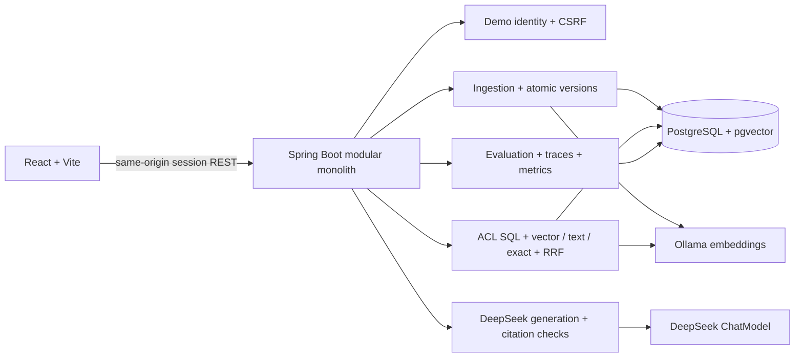

# Enterprise RAG Assistant

**Enterprise knowledge. Secure retrieval. Verifiable answers.**

A portfolio MVP showing an evidence-grounded enterprise knowledge assistant with document-level authorization, active document versions, hybrid retrieval, citations, offline evaluation, and safe bounded traces. It demonstrates enterprise architecture patterns; it is **not a production-ready SaaS service**.

All Acme Enterprise documents are synthetic and safe to publish.

## What Is Implemented

- Markdown, text, and extractable-PDF ingestion; scanned PDFs/OCR are unsupported.
- Local Ollama embeddings with `nomic-embed-text` and PostgreSQL/pgvector persistence.
- DeepSeek-backed answer generation, configured independently from embeddings.
- ACL-constrained vector, PostgreSQL full-text, and exact-identifier retrieval, fused with RRF.
- Server-issued demo sessions, role-scoped SQL retrieval, authorized source previews, and citations.
- Staged version indexing with transactionally activated chunks and version permissions.
- A 52-scenario deterministic offline retrieval evaluation. It measures retrieval, ACL, freshness, citation-ID logic, and evidence-based abstention policy; it does not measure generated-answer correctness.
- Bounded RAG traces, role-scoped trace APIs, 30-day default retention, and low-cardinality metrics.
- React chat, knowledge-management, and evaluation workspaces.

## Architecture



More detail is in [`docs/architecture.md`](docs/architecture.md), [`docs/security-design.md`](docs/security-design.md), [`docs/retrieval-design.md`](docs/retrieval-design.md), and [`docs/evaluation-design.md`](docs/evaluation-design.md).

## Quick Start

Requirements: Docker Desktop with Compose, a supported JDK 21 for local Java checks, and a DeepSeek API key to generate answers. The first startup downloads the Ollama image/model and may take several minutes.

```bash
cp .env.example .env
# Edit .env and set DEEPSEEK_API_KEY for generated answers.
docker compose up --build -d
```

Open `http://localhost:3000`. The Compose stack runs PostgreSQL/pgvector, Ollama, one-time embedding-model setup, the Spring backend, and the React/Nginx frontend. Synthetic docs seed at backend startup. Ollama pulls `${EMBEDDING_MODEL:-nomic-embed-text}` into its persistent volume.

The app login is a demo identity selector, not password authentication. Compose defaults `CHAT_MODEL_PROVIDER=none`, so the app can start and browse/test without paid credentials; chat reports generation is disabled and returns authorized citation IDs for inspection. To enable DeepSeek answers, set `DEEPSEEK_API_KEY` and `CHAT_MODEL_PROVIDER=deepseek` in `.env`, then run `docker compose up --build -d` again. Offline evaluation and tests do not require this key.

### Local Backend Development

With PostgreSQL and Ollama available at the configured URLs:

```bash
cd backend
./mvnw spring-boot:run
```

The default seed path is `../synthetic-docs`; set `APP_SEED_ENABLED=true` and `APP_SEED_PATH` as needed. Pull the local embedding model once with `ollama pull nomic-embed-text` if Ollama does not already have it.

## Developer Commands

| Command | Purpose |
|---|---|
| `make up` | Build and start the Compose stack |
| `make down` | Stop the stack (preserves named volumes) |
| `make logs` | Follow service logs |
| `make seed` | Start/rebuild the backend with startup seeding enabled |
| `make test` | Run backend tests, Testcontainers, analysis, and coverage gates |
| `make frontend-test` | Run React component tests |
| `make eval` | Sign in as Carol and run the offline 52-scenario suite (requires `jq`) |

Backend quality gate, on Java 21:

```bash
cd backend && ./mvnw verify
```

This runs unit tests, PostgreSQL/pgvector Testcontainers integration tests, PMD, SpotBugs, ArchUnit, and JaCoCo class/method coverage thresholds. JaCoCo reports are written under `backend/target/site/jacoco/`. Frontend checks:

```bash
cd frontend && npm ci && npm run build && npm test -- --run && npm audit --audit-level=moderate
```

## Demo Identities

| Identity | Retrieval roles | Management/evaluation |
|---|---|---|
| Alice | Public, Engineering | No |
| Bob | Public, HR | No |
| Carol | Public, Security | Explicit document admin |

Carol’s document-management capability is separate from her retrieval scope. She can manage document metadata and evaluations, but only public/security evidence is eligible for her chat. Changing client-side role fields cannot grant access.

## Demo Scenarios

1. **Evidence-grounded answer:** ask “What is the Enterprise API rate limit, and how should clients handle HTTP 429?” Open citations and inspect the trace.
2. **Permission isolation:** compare Alice and Bob on an HR-only policy. Alice should not receive HR evidence; direct source resolution independently applies access checks.
3. **Freshness/evaluation:** sign in as Carol, upload a newer policy under its logical document ID, then query again and run the offline evaluation. Inspect the active version and actual persisted results.

## API Overview

- `GET /api/auth/csrf`, `POST /api/auth/login`, `GET /api/auth/me`, `POST /api/auth/logout`
- `POST /api/chat`
- `GET /api/sources/{chunkId}`
- `GET /api/documents`, `POST /api/documents`, `POST /api/documents/{id}/reindex`, `GET /api/documents/{id}/versions`, `DELETE /api/documents/{id}`
- `POST /api/evaluations/run`, `GET /api/evaluations`, `GET /api/evaluations/{runId}`
- `GET /api/traces/{traceId}`

Mutating browser requests require the session CSRF token. Document mutation and evaluation endpoints require Carol’s explicit admin capability. Ordinary document list/version metadata is role filtered; trace detail is owner/admin scoped.

Example chat request after login:

```json
{"message":"What is the Enterprise API rate limit?"}
```

Example response fields include `answer`, resolvable `citations`, `traceId`, and `groundingStatus`. Citation validity does not imply that every answer claim is factually correct.

## Evaluation and Observability

The offline dataset version is `2026-10-m3-v1`. Offline results use retrieval only and do not call DeepSeek. Recall@5/MRR are calculated for answerable evidence scenarios. ACL leakage counts forbidden candidates. Freshness uses expected active versions. Citation and abstention metrics validate deterministic application logic, not LLM answer quality. There are no placeholder benchmark scores in the UI.

Traces store a query hash and bounded timing/count/provider/status fields, not raw queries or retrieved text. Trace retention defaults to 30 days. Micrometer metrics avoid user/document/query labels. Chat persistence of a trace is best-effort so a telemetry write issue does not replace a successful answer with a failed request.

## Verification Status

The required backend quality gate has passed during M3/M4 development on Java 21 with Docker-backed pgvector tests. Re-run it after changes using `cd backend && ./mvnw verify`; do not treat prior runs as results for a modified worktree. Frontend unit tests and production build have passed. Compose syntax and both Docker image builds have passed.

**Compose startup was verified.** PostgreSQL and backend healthchecks passed, migrations v1/v2 applied, 20 synthetic documents/35 chunks were seeded, and Nginx served the UI. The offline 52-scenario suite was run twice after backend restarts; both runs succeeded with identical measured results: Recall@5 1.0, MRR 0.8976, ACL leakage 0, freshness 1.0, citation logic 1.0, and abstention policy 1.0. The active rate-limit policy remained at version 4 with one active version across the repeat restart. These are retrieval/application-logic measurements, not generated-answer quality scores.

No live DeepSeek generation smoke test or browser-driven local functional test has been completed. The stack is currently configured with chat generation disabled (`CHAT_MODEL_PROVIDER=none`) and returns authorized citation IDs for inspection without a paid key. Do not infer generated-answer benchmark results from the offline suite.

## Limitations

- Demo login is an identity selector without passwords or SSO.
- ACLs are enforced in application SQL; PostgreSQL RLS is not configured.
- Local demo defaults, Compose credentials, prompt text, and citation validation are not a production security boundary.
- No DLP, OCR, connectors, distributed indexing queue, approximate-vector index, Kubernetes, live judge, or generated-answer benchmark.
- Structured JSON logging and full request-stage trace spans are not implemented.
- Docker Hub availability and first-time model downloads are external setup dependencies.

## Portfolio Case Study

See [`docs/portfolio-case-study.md`](docs/portfolio-case-study.md). Screenshot and demo-video placeholders remain until actual captures are made.

## Future Work

After M4, improve retrieval/evaluation tests, add explicitly enabled live answer evaluation and clearly labeled LLM-as-a-Judge results, then perform provider smoke tests and local functional testing. Production work would additionally require real identity integration, operational hardening, security review, and deployment-specific controls.
