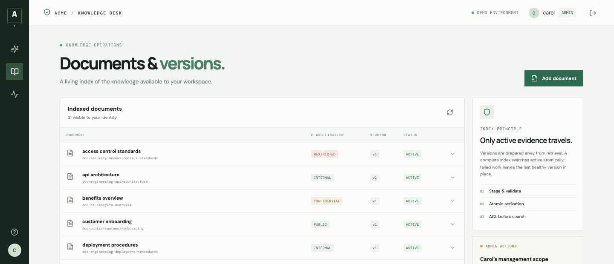
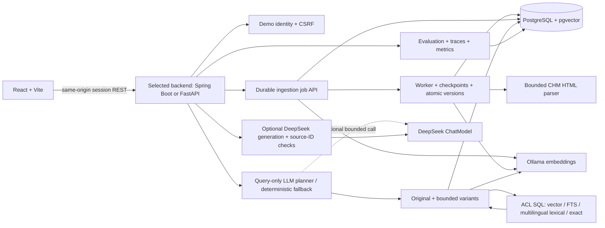

# Enterprise RAG Assistant

[](https://github.com/chen3862000-coder/enterprise-rag-assistant/actions/workflows/verify.yml)

**Enterprise knowledge. Authorized retrieval. Inspectable sources.**

A portfolio MVP showing document-level authorization, active document versions, hybrid retrieval, source-authorized citations, deterministic evidence sufficiency, offline evaluation, and safe bounded traces. Citation IDs are source references, not claim-level verification. It demonstrates architecture patterns; it is **not a production-ready SaaS service**.

All Acme Enterprise documents are synthetic and safe to publish.



## What Is Implemented

- Markdown, text, extractable-PDF, and bounded CHM HTML ingestion; scanned PDFs/OCR are unsupported.
- Local Ollama embeddings with `nomic-embed-text` and PostgreSQL/pgvector persistence.
- Optional DeepSeek-backed answer generation, configured independently from embeddings.
- ACL-constrained vector, English full-text, multilingual Latin/CJK lexical-term, and exact-identifier retrieval, fused with RRF.
- Optional LLM query understanding and bounded multilingual rewrites, with deterministic timeout/failure fallback and original-query baseline preservation.
- Server-issued demo sessions, role-scoped SQL retrieval, authorized source previews, and citations.
- Durable asynchronous ingestion jobs with bounded batch progress/checkpoints and transactionally activated chunks/version permissions; prior active versions survive failures.
- Explicit restore for disabled/deleted documents; uploads cannot silently reactivate an inactive logical document.
- Separate 63-scenario development and 40-scenario held-out offline evaluation reports. Java persists them independently; Python retains separate metrics in its compatibility run. Neither measures generated-answer correctness.
- Bounded RAG traces, role-scoped trace APIs, 30-day default retention, and low-cardinality metrics.
- React chat, knowledge-management, and evaluation workspaces.

## Architecture

Two independently runnable backend implementations are available: Java/Spring Boot is the default, and Python/FastAPI is selected with the Compose override described in [`docs/python-backend.md`](docs/python-backend.md). Both implement durable ingestion, bounded CHM extraction, multilingual lexical retrieval, a bounded query planner with deterministic fallback, SQL ACL-before-fusion filtering, and the same evidence-gate contract. Session cookies, parser limits/PDF libraries, prefix-shadow support, and evaluation persistence differ. Exact per-scenario equivalence is not yet established; see [`docs/backend-parity.md`](docs/backend-parity.md).



More detail is in [`docs/architecture.md`](docs/architecture.md), the [DDD system design](docs/ddd-system-design.md), [`docs/security-design.md`](docs/security-design.md), [`docs/retrieval-design.md`](docs/retrieval-design.md), [`docs/evaluation-design.md`](docs/evaluation-design.md), and [`docs/local-cluster.md`](docs/local-cluster.md).

## Quick Start

Requirements: Docker Desktop with Compose, a supported JDK 21 for local Java checks, and a DeepSeek API key to generate answers. The first startup downloads the Ollama image/model and may take several minutes.

```bash
cp .env.example .env
# Edit .env and set DEEPSEEK_API_KEY for generated answers.
docker compose up --build -d
```

Open `http://localhost:3000`. The Compose stack runs PostgreSQL/pgvector, Ollama, one-time embedding-model setup, the Spring backend, and the React/Nginx frontend. Synthetic docs seed at backend startup. Ollama pulls `${EMBEDDING_MODEL:-nomic-embed-text}` into its persistent volume.

To select the separate Python implementation without frontend source changes:

```bash
docker compose -f compose.yaml -f compose.python.yaml up --build --wait
```

Use the same Compose files with `down` to stop that selected project. Only one backend service is selected at a time; switching implementations requires a fresh demo login because each backend owns its own session cookie. Python-specific commands and limitations are documented in [`docs/python-backend.md`](docs/python-backend.md).

### Local Cluster Control

For a checked host-level workflow that builds, starts, waits for readiness, and stops the local Compose cluster:

```bash
./scripts/start-cluster.sh
./scripts/start-cluster.sh --backend python
./scripts/stop-cluster.sh
```

Use `--project` and `--port` to isolate a second stack, and `--volumes` on shutdown only when you intend to delete local PostgreSQL/Ollama data. The scripts preserve volumes by default, refuse backend changes within an existing project, and do not prune unrelated Docker resources. See [`docs/local-cluster.md`](docs/local-cluster.md) for prerequisites, switching backends, status/log commands, and troubleshooting.

The app login is a demo identity selector, not password authentication. Compose defaults `CHAT_MODEL_PROVIDER=none`, so generated prose is disabled; retrieval remains available. Query planning is separate: Java defaults to the optional DeepSeek planner (`QUERY_PLANNER_PROVIDER=deepseek`, 5-second timeout) and falls back deterministically when disabled, unconfigured, invalid, or timed out. Offline Java evaluation forces deterministic planning. Set `DEEPSEEK_API_KEY` and `CHAT_MODEL_PROVIDER=deepseek` independently to enable answer generation. Planner calls send the user query to DeepSeek and may incur latency/cost.

### Local Backend Development

With PostgreSQL and Ollama available at the configured URLs:

```bash
cd backend
./mvnw spring-boot:run
```

The default seed path is `../synthetic-docs`; set `APP_SEED_ENABLED=true` and `APP_SEED_PATH` as needed. Pull the local embedding model once with `ollama pull nomic-embed-text` if Ollama does not already have it.

## Developer Commands

| Command | Purpose |
|---|---|
| `make up` | Build and start the Compose stack |
| `make down` | Stop the stack (preserves named volumes) |
| `make logs` | Follow service logs |
| `make seed` | Start/rebuild the backend with startup seeding enabled |
| `make test` | Run backend tests, Testcontainers, analysis, and coverage gates |
| `make frontend-test` | Run React component tests |
| `make eval` | Sign in as Carol and run separate development/held-out reports (requires `jq`) |
| `./scripts/start-cluster.sh` | Build, start, and health-check the local Java cluster |
| `./scripts/start-cluster.sh --backend python` | Start the Python cluster |
| `./scripts/stop-cluster.sh` | Stop the selected project; preserve volumes |
| `make cluster-start ARGS="--backend python"` | Start through the Make wrapper |
| `make cluster-stop ARGS="--project NAME"` | Stop a specific project |

Backend quality gate, on Java 21:

```bash
cd backend && ./mvnw verify
```

This runs unit tests, PostgreSQL/pgvector Testcontainers integration tests, PMD, SpotBugs, ArchUnit, and JaCoCo class/method coverage thresholds. JaCoCo reports are written under `backend/target/site/jacoco/`. Frontend checks:

```bash
cd frontend && npm ci && npm run build && npm test -- --run && npm audit --audit-level=moderate
```

## Demo Identities

| Identity | Retrieval roles | Management/evaluation |
|---|---|---|
| Alice | Public, Engineering | No |
| Bob | Public, HR | No |
| Carol | Public, Security | Explicit document admin |

Carol’s document-management capability is separate from her retrieval scope. She can manage document metadata and evaluations, but only public/security evidence is eligible for her chat. Changing client-side role fields cannot grant access.

## Demo Scenarios

1. **Authorized evidence retrieval:** ask “What is the Enterprise API rate limit, and how should clients handle HTTP 429?” Inspect the gate reason, source references, and trace. Source IDs do not prove factual entailment.
2. **Permission isolation:** compare Alice and Bob on an HR-only policy. Alice should not receive HR evidence; direct source resolution independently applies access checks.
3. **Freshness/evaluation:** sign in as Carol, upload a newer policy under its logical document ID, then query again and run the offline evaluation. Inspect the active version and actual persisted results.

## API Overview

- `GET /api/auth/csrf`, `POST /api/auth/login`, `GET /api/auth/me`, `POST /api/auth/logout`
- `POST /api/chat` (bounded structured query planning may run before retrieval)
- `GET /api/sources/{chunkId}`
- `GET /api/documents`, `POST /api/documents` (`202` + job ID), `POST /api/documents/{id}/reindex` (`202` + job ID), `GET /api/ingestions/{jobId}`, `GET /api/documents/{id}/ingestions`, `GET /api/documents/{id}/versions`, `POST /api/documents/{id}/disable`, `POST /api/documents/{id}/restore`, `DELETE /api/documents/{id}` (soft delete)
- `POST /api/evaluations/run`, `GET /api/evaluations`, `GET /api/evaluations/{runId}`
- `GET /api/traces/{traceId}`

Mutating browser requests require the session CSRF token. Document mutation and evaluation endpoints require Carol’s explicit admin capability. Ordinary document list/version metadata is role filtered; trace detail is owner/admin scoped.

Example chat request after login:

```json
{"message":"What is the Enterprise API rate limit?"}
```

Example response fields include `answer`, resolvable `citations`, `traceId`, and `groundingStatus`. `CITATIONS_PRESENT` means authorized source IDs were attached; it does not mean claims were independently verified. The deterministic evidence gate returns `INSUFFICIENT_EVIDENCE` and no citations for weak/unsupported evidence.

## Evaluation and Observability

Offline evaluation persists independent development (`2026-10-p1-v5`, 63 scenarios) and held-out (`heldout-paraphrases-v3`, 40 scenarios) reports; datasets are never pooled for reporting or threshold tuning. Evaluation does not call answer generation or an LLM judge. Java forces deterministic query planning by default; explicitly configured planner calls are bounded. Evaluation measures relevance from pre-gate authorized candidates and records the gate separately. Latest corrected exploratory held-out runs show gate accuracy 0.875 in Python and 0.925 in Java; false-abstention/false-admission are 19.23%/0% and 11.54%/0%, respectively, with zero ACL leakage. Java's remaining abstentions are request-ID/CSD paraphrases where no single candidate met all joint gate signals. The inspected synthetic held-out set is not blind release evidence, and aggregate results do not prove full per-query parity.

Earlier Java and Python measurements in the implementation history used the pre-parity retrieval behavior and are historical only. The current backends now support separate 63-case development and 40-case held-out reports; the held-out set has been inspected during development and is exploratory, not blind release evidence. No current paired Java/Python metric claim is made until both are rerun against the same seeded corpus and planner mode. These synthetic-corpus reports measure retrieval and gate behavior, not generated-answer correctness or faithfulness.

Traces store a query hash and bounded timing/count/provider/status fields, not raw queries or retrieved text. Trace retention defaults to 30 days. Micrometer metrics avoid user/document/query labels. Chat persistence of a trace is best-effort so a telemetry write issue does not replace a successful answer with a failed request.

## Verification Status

Verification last run locally on 2026-10-29; these outcomes describe the checked worktree only, not a permanent guarantee. Java backend: `cd backend && ./mvnw verify` on Java 21 passed (66 unit tests, 40 Testcontainers PostgreSQL/pgvector integration tests, PMD, SpotBugs, ArchUnit, and JaCoCo thresholds); the integration tests applied Flyway migrations through V15. Python backend: `uv run ruff format --check app tests`, `uv run ruff check app tests`, `uv run mypy app`, `uv run pytest`, and `uv run pip-audit` passed (31 tests including real PostgreSQL/pgvector Testcontainers, 77.39% coverage, and no known dependency vulnerabilities). Frontend: `cd frontend && npm run build && npm test -- --run && npm audit --audit-level=moderate` passed (5 tests and zero audit findings). Browser workflows: `cd frontend && npm run test:e2e` passed all 3 Playwright workflows against the final Python backend, including citation/source preview, ACL denial, upload/versioning, trace, evaluation, and structured errors. The browser run reused cached Docker images because Docker Hub was temporarily unavailable for a fresh build. Compose configuration for both backends validated; a fresh registry-dependent cold start was not re-run in this final pass. Cluster scripts: Bash syntax, help, backend-mismatch rejection, safe missing-project shutdown, and the Java start/health path passed; `shellcheck` was not installed. The GitHub Actions `Verify` workflow runs the Java, frontend, browser, and Compose checks on pull requests and pushes to `main`.

The Python implementation stores its Java-compatible combined run with separate metric groups; Java stores separate development and held-out run records. Always report each dataset independently. Evaluation measures retrieval/evidence-gate behavior, not generated-answer quality.

Playwright browser workflows run with `cd frontend && npm run test:e2e`. The checked Compose stack uses `CHAT_MODEL_PROVIDER=none`; live DeepSeek generation remains unverified unless an owner supplies an external API key for a smoke test. Do not infer generated-answer benchmark results from the offline suite.

## Limitations

- Demo login is an identity selector without passwords or SSO.
- ACLs are enforced in application SQL; PostgreSQL RLS is not configured.
- Local demo defaults, Compose credentials, prompt text, and citation validation are not a production security boundary.
- No DLP, OCR, connectors, external broker/distributed orchestration platform, approximate-vector index, Kubernetes, live judge, or generated-answer benchmark. Durable database-backed ingestion workers are implemented. Gate thresholds are MVP heuristics calibrated on this small synthetic corpus; they can false-abstain or admit coincidental term/vector matches on other corpora.
- Structured JSON logging and full request-stage trace spans are not implemented.
- Java and Python use backend-specific session cookies and stores; switching implementations requires signing in again.
- Python PDF extraction uses `pypdf` and may differ from Java's PDFBox output. Python does not implement the prefix-shadow evaluation used by the Java experiment and reports those metrics as unavailable.
- Both backends implement the same planned retrieval/gate inputs and separately defined datasets, but complete per-scenario behavioral parity and a blind held-out result are not yet established. Python currently reports intent `UNKNOWN` in deterministic fallback; semantic intent requires its configured LLM planner.
- Docker Hub availability and first-time model downloads are external setup dependencies.

## Portfolio Case Study

See [`docs/portfolio-case-study.md`](docs/portfolio-case-study.md). Genuine local UI captures are available for the [knowledge workspace](frontend/docs/media/knowledge-workspace.png), [persisted evaluation](frontend/docs/media/evaluation-workspace.png), and [chat with authorized source preview](frontend/docs/media/chat-source.png). No demo video has been recorded yet.

## Future Work

- Freeze a new uncontaminated held-out paraphrase set and report development and held-out results separately.
- Run a direct Java/Python per-scenario contract and evaluation comparison, including intentional differences.
- Decide whether to implement Python prefix-shadow evaluation or formally waive it; compare PDF extraction across `pypdf` and PDFBox.
- Add explicitly enabled live answer evaluation and clearly labeled LLM-as-a-Judge results, plus DeepSeek provider smoke tests.
- Verify Python startup against a persistent Java-created database and a fresh registry-dependent Compose cold start.
- For production use, add real identity integration, operational hardening, security review, and deployment-specific controls.
