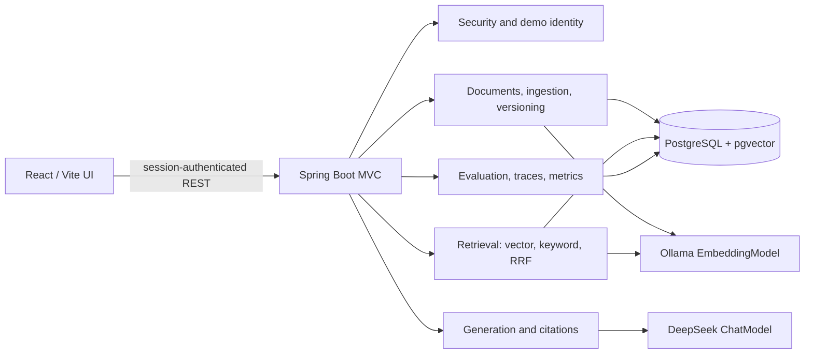

# M0 Architecture and Compatibility

## Purpose and Scope

Enterprise RAG Assistant is a portfolio MVP demonstrating secure, evidence-grounded retrieval, document freshness, evaluation, and operational visibility. It is not a production SaaS product and must not claim production readiness based on these patterns alone. All example company data is synthetic.

The repository starts from an empty application skeleton. This document records the approved M0 design and the decisions confirmed before M1 implementation.

## Compatibility Findings

The initial dependency line is Spring Boot 4.1.2 with Spring AI 2.0.2. The Spring AI 2.0 documentation states compatibility with Spring Boot 4.0.x and 4.1.x. Spring Boot 4.1.2 requires Java 17 or later and supports Java through 27, so the requested Java 21 runtime is supported.

Spring AI documents dedicated DeepSeek chat and Ollama embedding starters. Chat generation and embedding generation will therefore be configured independently. DeepSeek is the default online chat provider; local Ollama is the embedding provider. The candidate embedding model is `nomic-embed-text` (768 dimensions); the model identity and dimensions will be stored with each indexed version. Model availability and the actual dependency combination must be smoke-tested in the project build before being treated as verified.

PostgreSQL with pgvector provides cosine vector distance, exact nearest-neighbor search, and combination with PostgreSQL full-text search. Retrieval will use explicit parameterized JDBC queries rather than exposing a generic vector-store search path, so ACL predicates remain visible and testable in SQL. Exact vector search is sufficient for this small synthetic corpus and avoids approximate-index filtering/recall complications.

### Local Environment at M0

- Java 27 is installed; Java 21 was not present during M0 inspection.
- Maven and Maven Wrapper were absent; M1 adds and verifies the wrapper.
- Docker and Docker Compose are available, and the Docker daemon is running.
- Node.js 24 and npm 11 are available.
- Ollama CLI 0.40.10 is installed, but its server was not running. Update/verify it before embedding integration tests.
- The repository initially contained only this project's placeholder README.

## Architecture

Use a modular monolith: one Spring MVC backend, one React/Vite frontend, and PostgreSQL as both relational system of record and vector store. Ollama serves embeddings locally; DeepSeek serves answer generation. Docker Compose supports local reproducibility.



Keep the security, document lifecycle, ingestion, retrieval, generation, citation, evaluation, and observability responsibilities separate. Controllers should only handle transport concerns. Do not add Kafka, Kubernetes, Redis, Elasticsearch/OpenSearch, or a separate vector database for this MVP.

## Data Model

- `documents`: stable logical ID, title, department/classification, current version reference, status, timestamps.
- `document_versions`: logical document reference, monotonically increasing version number, SHA-256 content hash, source filename, effective time, indexing status, embedding model ID and dimensions, timestamps.
- `document_chunks`: stable chunk ID, version reference, chunk index, text, heading path, optional page number, pgvector embedding, PostgreSQL search vector, timestamp.
- `document_permissions`: logical document reference and allowed role. ACL applies consistently to every version and chunk.
- `ingestion_jobs`: document/version references, status, safe error detail, start/completion times.
- `rag_traces`: trace/user IDs, query hash, stage durations/counts, provider/model, citation count, status, timestamp. Do not routinely persist raw prompts or source content.
- `evaluation_runs` and per-scenario results: timestamp, dataset version, model and embedding identities, retrieval configuration, method, actual measured scores, and failures.

Use foreign keys and uniqueness constraints, including `(document_id, version_number)` and content-hash deduplication, plus indexes for logical document status, role permissions, active versions, full-text search, and vector search. Use a single configured embedding model and dimension for the active index. A model/dimension change requires reindexing and must not mix incompatible vectors in the active index.

## Identity and ACL Enforcement

The authenticated server-side Spring Security principal is the sole identity and role authority. The development demo login accepts only known demo identities; the server maps those identities to fixed roles and issues an HTTP-only, same-site session cookie. Client-supplied role, department, or user ID fields never grant access. Mutating cookie-authenticated requests require CSRF protection.

Vector, keyword, and exact-identifier SQL retrieval must apply the same database-side permission predicate, enabled-document check, and active-version check before rows leave the retrieval layer. Unauthorized candidates must never reach hybrid fusion or the LLM. Citation/source lookup, document listing, and trace access independently re-check authorization. Access revocation and disabling take effect in subsequent queries without waiting for vector cleanup.

Demo administration is an explicit permission, separate from access to security-classified documents. Carol is the demo administrator, but her `SECURITY_ADMIN` document-access role does not by itself imply document-management rights; management endpoints require the explicit demo admin capability. Alice and Bob are not administrators.

This is a deterministic application/database-query boundary suitable for demonstrating and testing ACL behavior. It is not PostgreSQL row-level security and does not constitute a production identity system.

## Document Lifecycle and Ingestion

Support Markdown, plain text, and PDFs with extractable text; scanned PDFs and OCR are out of scope. Validate type and size, normalize filenames/content, hash content, detect duplicates, preserve source/heading/page metadata, and use configurable overlap-aware chunking.

New logical documents receive a stable logical document ID. Updating an existing document requires that logical ID and creates a new version; it must never silently create another logical document. Parse and embed into a non-active version, persist all chunks, validate counts/model dimension, then atomically switch `current_version_id` and mark the version active. Failure leaves the prior version active and the failed version unavailable. Serialize reindexing per logical document to prevent competing active versions. Identical content hashes avoid unnecessary embedding work.

## Retrieval and Answer Generation

```text
Authenticated request
  -> normalize query / embed
  -> ACL-constrained vector retrieval (PostgreSQL)
  -> ACL-constrained full-text + exact identifier retrieval
  -> Reciprocal Rank Fusion (RRF)
  -> bounded context with request-local citation IDs
  -> DeepSeek ChatModel generation
  -> citation authorization/version/existence validation
  -> grounded answer or explicit abstention
```

Use cosine distance with exact vector search for the MVP. Keyword search uses PostgreSQL full-text search plus an exact-match path for technical identifiers, error codes, and configuration keys. Fuse rank lists with configurable RRF; do not compare raw scores across retrieval methods. Deduplicate by stable chunk ID.

Context assembly enforces a token/size budget, preserves ranking, and assigns citation IDs only to chunks actually supplied to the model. Source text is untrusted data, never instructions. Validate every citation against the supplied context and re-check user ACL and active version before returning source metadata or preview. Empty/weak evidence yields explicit abstention. Citation validity is not equivalent to factual correctness; malformed/unsupported model output receives a safe fallback.

## Evaluation and Observability

Version a deterministic 52-scenario JSONL dataset across fact lookup, multi-document QA, exact match, permissions, unanswerable questions, and freshness. Offline retrieval/security evaluation requires PostgreSQL and local embeddings but no paid chat-model key. Pure fixture/unit coverage for RRF, ACL policy, citation validation, and deterministic abstention should not require infrastructure. Optional live generation/judge evaluation is separately enabled and labeled as model-generated judgment, not objective ground truth.

Record bounded trace data for request identity/scope, retrieval methods and counts, fusion/context, provider/model, citation checks, durations, and error category. Do not log raw query text or full document content. Restrict trace reads and re-authorize document metadata. Micrometer labels must be bounded; never label metrics with user IDs, document IDs, or query text.

## Proposed Dependency Families

- Spring Boot MVC, Security, JDBC, validation, Actuator, and Flyway.
- Spring AI DeepSeek chat and Ollama embedding starters, managed through the Spring AI BOM.
- PostgreSQL JDBC driver and pgvector-enabled PostgreSQL container image.
- JUnit 5, Spring Boot Test, and Testcontainers PostgreSQL/pgvector integration tests.
- Apache PDFBox for extractable PDF text, subject to build/API verification.
- React, TypeScript, Vite, and a restrained component/styling stack.

Pin the exact dependency versions and add Maven Wrapper. Prefer direct JDBC retrieval SQL for explicit ACL constraints. Optional Grok may later use an OpenAI-compatible Spring AI adapter only after verifying xAI's current API endpoint and request compatibility.

## M1-M4 Implementation Plan

### M1: Document Ingestion

Establish the Maven build/wrapper and backend package boundaries; implement Flyway schema, deterministic synthetic fixtures, parsers, normalization, chunking, local embedding integration, persistence, version/job state, hash deduplication, atomic activation, and ingestion tests. No chat generation or frontend is required for M1.

### M2: Secure RAG Pipeline

Implement fixed server-authenticated demo users, explicit admin authorization, ACL-constrained vector/keyword/exact-match queries, RRF, DeepSeek generation, citation validation/source preview, and security/abstention tests.

### M3: Evaluation and Observability

Implement all 52 scenarios, offline metrics and failure diagnostics, optional live evaluation, bounded traces, and low-cardinality Micrometer metrics.

#### M3 Implementation Status

- `evals/dataset.jsonl` is loaded as version `2026-10-m3-v1` and validates 52 unique scenarios with the specified category distribution.
- Offline evaluation is retrieval-only and does not call the ChatModel. It runs as Alice/Bob/Carol's fixed server-defined role scopes, persists an evaluation run and each scenario's expected/retrieved/forbidden document IDs, freshness, ACL, citation-ID-logic, and deterministic evidence-based abstention flags. Recall@5 and MRR average answerable retrieval cases only; unanswerable cases are evaluated for abstention policy separately.
- Citation logic accuracy is a deterministic validator check, not answer quality. Offline run records use method `OFFLINE_RETRIEVAL`; no LLM faithfulness or answer correctness metric is emitted. Those require optional live evaluation and are not part of this M3 run.
- Chat writes trace UUIDs and hashed user-query text plus bounded counts/durations/model/status metadata; raw query and source text are not stored. Trace reads are scoped to the owner or explicit demo administrator. Trace retention defaults to 30 days and is configurable through `TRACE_RETENTION_DAYS` and `TRACE_CLEANUP_CRON`.
- Micrometer metrics cover request counts, retrieval/generation latency, empty retrieval, invalid citation IDs, ACL denied access, ingestion result, and offline evaluation run counts without user/document/query labels.
- Evaluation run endpoints require Carol's explicit document-admin capability. Trace source/document metadata is not returned through traces.
- Verification: Java 21 `./mvnw clean verify -q` passed with Testcontainers PostgreSQL/pgvector available. Surefire unit tests, four Failsafe integration classes, architecture tests, PMD, SpotBugs, and JaCoCo gates passed. JaCoCo reports 79% instruction coverage; class and method thresholds remain over 70%. `git diff --check` passed.

M3 limitations: live generation/judge evaluation is not implemented; deterministic abstention is a retrieval-policy indicator rather than model answer-quality evaluation. Trace persistence is best-effort for chat availability. Structured stage traces beyond bounded timings/counts and provider/status fields remain limited, and log output is not yet configured as structured JSON.

### M4 Implementation Status

- Added a React/Vite frontend with demo identity selection, CSRF-aware session requests, chat citations/source previews/traces, knowledge list/upload/version/disable, and evaluation run/result diagnostics.
- Added admin-only document-management APIs. Admin metadata listing is separate from role-based chat and source authorization. Version role permissions are now changed inside the same successful activation transaction; failed indexing preserves the prior ACL along with the prior active version. The frontend passes an explicit logical document ID for both new logical documents and updates.
- Added Dockerfiles, Compose services for PostgreSQL/pgvector, Ollama/model initialization, backend and Nginx frontend, `.env.example`, `.dockerignore`, and Make targets. Nginx proxies same-origin API traffic so session and CSRF behavior does not require wildcard CORS.
- Added security, retrieval, and evaluation documents plus the portfolio case study and README.
- Frontend `npm run build`, `npm test -- --run` (4 component tests), `npm audit --audit-level=moderate`, `docker compose config --quiet`, and `docker compose build` passed during M4 development. The final Java 21 `./mvnw clean verify -q` passed with M4 document-management and version-permission tests included; coverage, PMD, SpotBugs, and architecture gates passed.

M4 validation: Compose startup is now verified after Docker Hub recovered. The embedding model pulled, all services reached healthy/running status, Flyway v1/v2 applied, and the synthetic corpus seeded 20 documents / 35 chunks. Two independent Carol-triggered offline 52-scenario runs after backend restart returned identical measured metrics: Recall@5 1.0, MRR 0.8976, ACL leakage 0, freshness 1.0, citation logic 1.0, abstention policy 1.0; no scenarios failed. The current rate-limit policy remained at version 4 and only one version stayed active across repeat backend restart. A no-key Alice chat request returned the explicit disabled-generation fallback with correctly formatted authorized citation IDs. Alice's client role spoof was ignored and Bob's direct restricted source request returned 404. These are local functional checks without a live chat provider. DeepSeek generation smoke tests and browser-driven UI scenario tests remain pending.

### M4: Frontend and Portfolio Packaging

Implement chat, knowledge management, and evaluation views; Compose/Make developer workflow; README, security/retrieval/evaluation docs, portfolio case study, demo scripts, and final verification.

Hybrid search with RRF is included in the initial retrieval pipeline. Optional Grok and judge evaluation may be deferred to protect core ACL, freshness, and offline evaluation correctness.

## M2 Implementation Status

Implemented in the backend:

- Fixed server-side demo identities: Alice has `PUBLIC`/`ENGINEERING`, Bob has `PUBLIC`/`HR`, and Carol has `PUBLIC`/`SECURITY_ADMIN` plus a separate document-admin capability. Unknown usernames are rejected; request `role` fields have no authority.
- HTTP session login/logout, session-ID rotation on login, HTTP-only/same-site strict session cookies, and session-backed CSRF protection for unsafe methods. Demo login can be disabled with `DEMO_AUTHENTICATION_ENABLED=false`.
- Parameterized PostgreSQL/pgvector cosine retrieval, PostgreSQL full-text retrieval, exact identifier retrieval, and RRF. Each candidate SQL query constrains role, enabled state, active version, and active index status before rows reach fusion.
- Context assembly with bounded size, request-local citations, source delimiters, and escaping of source-supplied angle-bracket tags. DeepSeek is configured as the default chat provider; Ollama embeddings remain separately configured.
- Citation IDs are restricted to evidence passed to generation. Invalid or absent citation IDs trigger an abstention fallback. Citation/source authorization and current-version status are rechecked after generation; source preview independently applies the same database predicates.
- Deterministic tests cover identity spoofing, login CSRF/session behavior, ACL-constrained vector/keyword/exact retrieval, revocation, disabled/superseded versions, direct source access, RRF, citation validation, and prompt-context escaping.
- M2 verification ran `./mvnw clean verify` on Java 21 with Docker-backed pgvector Testcontainers. Unit, authentication, ingestion, retrieval, architecture, PMD, SpotBugs, and JaCoCo gates passed. JaCoCo bundle coverage is 77% instruction, 57% branch, 74% line, 76% method, and 100% class; only the required class/method thresholds gate the build.

M2 remains an MVP, not production identity/security. The demo login is an identity selector without password verification and must only be enabled for a local controlled demonstration. No document administration HTTP endpoints are implemented yet despite Carol's explicit capability. The frontend CSRF/session integration is pending M4. Live DeepSeek and Ollama network smoke tests have not been run. PostgreSQL ACL predicates are application query boundaries; PostgreSQL row-level security is not configured. Prompt wording is not a guarantee of prompt-injection immunity or factual correctness.

## Confirmed Decisions

1. Carol is an explicit demo administrator. Document-management capability is separate from Carol's access to security documents.
2. New logical documents receive a stable logical ID; updates require that ID and create a new version.
3. Hybrid vector + keyword retrieval and RRF are included; optional provider switching/live judge work is lower priority.

## Risks and Limitations

- Spring Boot 4 / Spring AI 2 are a new major-version line; exact artifacts and runtime APIs must be verified by the Maven build and integration tests.
- The installed Ollama version was old at M0 and its service was not running. Update and smoke-test before embedding tests; model download and local memory requirements affect first-run experience.
- The default `nomic-embed-text` context is listed as 2K tokens. Chunking must stay within model input limits; prompt/token estimates are model-dependent.
- pgvector HNSW indexes support at most 2,000 dimensions for `vector`; the proposed 768-dimensional model fits. Exact search avoids approximate filter-recall effects for this MVP.
- A 25-30 hour portfolio budget is tight for 52 curated scenarios, robust PDF parsing, full UI, and broad integration coverage. Preserve ACL/version correctness before optional integrations and polish.
- Prompt instructions and citation checks reduce risk but do not prove factual correctness or guarantee prompt-injection immunity.
- Demo identities, local Compose secrets, and the absence of SSO, production DLP, distributed job orchestration, and formal hardening are explicit MVP simplifications.

## References

- [Spring AI 2.0 Getting Started](https://docs.spring.io/spring-ai/reference/getting-started.html)
- [Spring Boot System Requirements](https://docs.spring.io/spring-boot/system-requirements.html)
- [Spring AI DeepSeek Chat](https://docs.spring.io/spring-ai/reference/api/chat/deepseek-chat.html)
- [Spring AI Ollama Embeddings](https://docs.spring.io/spring-ai/reference/api/embeddings/ollama-embeddings.html)
- [Spring AI PGvector](https://docs.spring.io/spring-ai/reference/api/vectordbs/pgvector.html)
- [pgvector documentation](https://github.com/pgvector/pgvector)
- [Ollama nomic-embed-text](https://ollama.com/library/nomic-embed-text)
