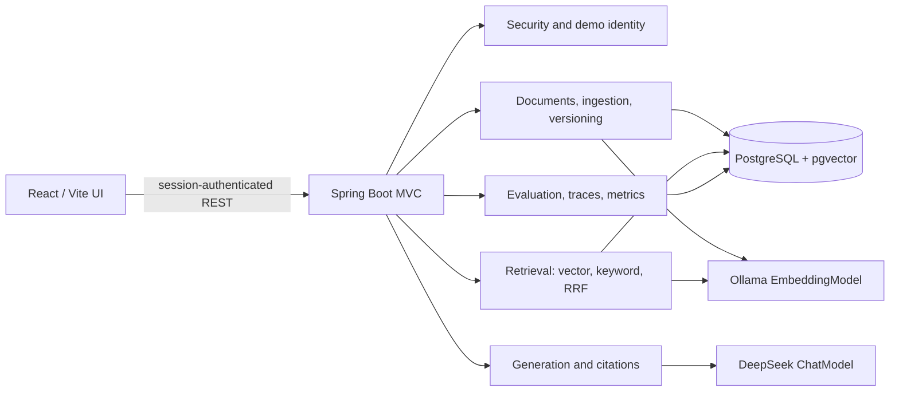

# Approved Architecture

## Purpose and Scope

Enterprise RAG Assistant is a portfolio MVP demonstrating secure, evidence-grounded retrieval, document freshness, evaluation, and operational visibility. It is not a production SaaS product and must not claim production readiness based on these patterns alone. All example company data is synthetic.

This document describes the current approved architecture and supported MVP boundaries. Historical milestone status and execution measurements belong in versioned evaluation reports or implementation history, not in this stable design description.

## Compatibility Findings

The implementation uses Spring Boot 4.1.2 with Spring AI 2.0.2 and is built and tested on Java 21.

Spring AI documents dedicated DeepSeek chat and Ollama embedding starters. Chat generation is optional and configured independently from local Ollama embeddings. The active embedding model is `nomic-embed-text` (768 dimensions); model identity and dimensions are stored with each indexed version.

PostgreSQL with pgvector provides cosine vector distance, exact nearest-neighbor search, and combination with PostgreSQL full-text search. Retrieval will use explicit parameterized JDBC queries rather than exposing a generic vector-store search path, so ACL predicates remain visible and testable in SQL. Exact vector search is sufficient for this small synthetic corpus and avoids approximate-index filtering/recall complications.

## Architecture

Use a modular monolith: one Spring MVC backend, one React/Vite frontend, and PostgreSQL as both relational system of record and vector store. Ollama serves embeddings locally; DeepSeek serves answer generation. Docker Compose supports local reproducibility.



Keep the security, document lifecycle, ingestion, retrieval, generation, citation, evaluation, and observability responsibilities separate. Controllers should only handle transport concerns. Do not add Kafka, Kubernetes, Redis, Elasticsearch/OpenSearch, or a separate vector database for this MVP.

## Data Model

- `documents`: stable logical ID, title, department/classification, current version reference, status, timestamps.
- `document_versions`: logical document reference, monotonically increasing version number, SHA-256 content hash, source filename, effective time, indexing status, embedding model ID and dimensions, timestamps.
- `document_chunks`: stable chunk ID, version reference, chunk index, text, heading path, optional page number, pgvector embedding, PostgreSQL search vector, timestamp.
- `document_permissions`: logical document reference and allowed role. ACL applies consistently to every version and chunk.
- `ingestion_jobs`: document/version references, status, safe error detail, start/completion times.
- `rag_traces`: trace/user IDs, query hash, stage durations/counts, provider/model, citation count, status, timestamp. Do not routinely persist raw prompts or source content.
- `evaluation_runs` and per-scenario results: timestamp, dataset version, model and embedding identities, retrieval configuration, method, actual measured scores, and failures.

Use foreign keys and uniqueness constraints, including `(document_id, version_number)` and content-hash deduplication, plus indexes for logical document status, role permissions, active versions, full-text search, and vector search. Use a single configured embedding model and dimension for the active index. A model/dimension change requires reindexing and must not mix incompatible vectors in the active index.

## Identity and ACL Enforcement

The authenticated server-side Spring Security principal is the sole identity and role authority. The development demo login accepts only known demo identities; the server maps those identities to fixed roles and issues an HTTP-only, same-site session cookie. Client-supplied role, department, or user ID fields never grant access. Mutating cookie-authenticated requests require CSRF protection.

Vector, keyword, and exact-identifier SQL retrieval must apply the same database-side permission predicate, enabled-document check, and active-version check before rows leave the retrieval layer. Unauthorized candidates must never reach hybrid fusion or the LLM. Citation/source lookup, document listing, and trace access independently re-check authorization. Access revocation and disabling take effect in subsequent queries without waiting for vector cleanup.

Demo administration is an explicit permission, separate from access to security-classified documents. Carol is the demo administrator, but her `SECURITY_ADMIN` document-access role does not by itself imply document-management rights; management endpoints require the explicit demo admin capability. Alice and Bob are not administrators.

This is a deterministic application/database-query boundary suitable for demonstrating and testing ACL behavior. It is not PostgreSQL row-level security and does not constitute a production identity system.

## Document Lifecycle and Ingestion

Support Markdown, plain text, and PDFs with extractable text; scanned PDFs and OCR are out of scope. Validate type and size, normalize filenames/content, hash content, detect duplicates, preserve source/heading/page metadata, and use configurable overlap-aware chunking.

New logical documents receive a stable logical document ID. Updating an existing document requires that logical ID and creates a new version; it must never silently create another logical document. Parse and embed into a non-active version, persist all chunks, validate counts/model dimension, then atomically switch `current_version_id` and mark the version active. Failure leaves the prior version active and the failed version unavailable. Serialize reindexing per logical document to prevent competing active versions. Identical content hashes avoid unnecessary embedding work. Disabled/deleted documents reject upload/reindex until an administrator explicitly restores them; duplicate content cannot silently reactivate them.

## Retrieval and Answer Generation

```text
Authenticated request
  -> normalize query / embed
  -> ACL-constrained vector retrieval (PostgreSQL)
  -> ACL-constrained full-text + exact identifier retrieval
  -> Reciprocal Rank Fusion (RRF)
  -> bounded context with request-local citation IDs
  -> DeepSeek ChatModel generation
  -> citation authorization/version/existence validation
  -> citation-constrained answer or evidence-gate abstention
```

Use cosine distance with exact vector search for the MVP. Keyword search uses PostgreSQL full-text search plus an exact-match path for technical identifiers, error codes, and configuration keys. Fuse rank lists with configurable RRF; do not compare raw scores across retrieval methods. Deduplicate by stable chunk ID.

The shared deterministic evidence gate is used after fusion by both chat and offline evaluation. It admits exact authorized identifier matches, or requires a fused candidate to have both minimum vector similarity and minimum full-text rank; candidates failing the gate are excluded from context, and chat returns `INSUFFICIENT_EVIDENCE` with no citations. Thresholds are configurable and calibrated against this synthetic English corpus, including hard negatives; they are not a universal semantic correctness guarantee.

Context assembly enforces a token/size budget, preserves ranking, and assigns citation IDs only to chunks actually supplied to the model. Source text is untrusted data, never instructions. Validate every citation against the supplied context and re-check user ACL and active version before returning source metadata or preview. Empty/weak evidence yields explicit abstention. Citation validity is not equivalent to factual correctness; malformed/unsupported model output receives a safe fallback.

## Evaluation and Observability

Version a deterministic JSONL dataset across fact lookup, multi-document QA, exact match, permissions, unanswerable questions, freshness, and hard negatives. Offline retrieval/security evaluation requires PostgreSQL and local embeddings but no paid chat-model key. Pure fixture/unit coverage for RRF, ACL policy, citation ID validation, and deterministic evidence sufficiency should not require infrastructure. Optional live generation/judge evaluation is separately enabled and labeled as model-generated judgment, not objective ground truth.

Record bounded trace data for request identity/scope, retrieval methods and counts, fusion/context, provider/model, citation checks, durations, and error category. Do not log raw query text or full document content. Restrict trace reads and re-authorize document metadata. Micrometer labels must be bounded; never label metrics with user IDs, document IDs, or query text.

## Dependency Families

- Java 21, Spring Boot 4.1.2 MVC, Security, JDBC, validation, Actuator, and Flyway.
- Spring AI 2.0.2 DeepSeek chat and Ollama embedding starters, managed through the Spring AI BOM.
- PostgreSQL JDBC driver and pgvector-enabled PostgreSQL container image.
- JUnit 5, Spring Boot Test, and Testcontainers PostgreSQL/pgvector integration tests.
- Apache PDFBox for extractable PDF text, subject to build/API verification.
- React, TypeScript, Vite, and a restrained component/styling stack.

Exact dependency versions and Maven Wrapper are checked in. Prefer direct JDBC retrieval SQL for explicit ACL constraints. Optional Grok may later use an OpenAI-compatible Spring AI adapter only after verifying xAI's current API endpoint and request compatibility.

## Runtime and Operations

The React/Vite frontend talks to the Spring MVC backend through a same-origin Nginx proxy. Browser sessions use HTTP-only/same-site cookies and CSRF tokens for unsafe requests. PostgreSQL/pgvector is the relational system of record and embedding store; Ollama generates embeddings. DeepSeek generation is optional and independently configured.

Chat applies the shared deterministic evidence gate after ACL-constrained vector, full-text, exact-identifier retrieval and RRF. Weak evidence is removed before context assembly; an insufficient gate result returns `INSUFFICIENT_EVIDENCE` with zero citations. `CITATIONS_PRESENT` means supplied authorized source IDs resolved successfully, not that answer claims were entailed by those sources.

The versioned offline suite has 63 scenarios, including hard negatives and additional permission-scope cases, and evaluates pre-gate retrieval, ACL isolation, freshness, citation-ID validation, and the shared evidence gate against explicit scenario labels. It does not call an LLM and does not measure generated-answer correctness, faithfulness, or model abstention accuracy. Run-specific retrieval/gate configuration, per-scenario numeric candidate diagnostics, diagnostic-only gate ablations, and a paired Nomic task-prefix shadow retrieval experiment are persisted. Shadow vectors are built only from SQL-authorized current chunks in memory and never replace active stored embeddings or affect runtime chat behavior.

Traces store hashed query identity and bounded counts, durations, provider/model, status, error category, evidence-gate decision, and gate reason; they do not store raw user query or source content. Trace persistence is best-effort for chat availability, reads are owner/admin scoped, and retention defaults to 30 days. Metrics use bounded labels only.

## Document Administration

Carol has a dedicated document-administration capability separate from retrieval roles. Re-submitting identical active content avoids re-embedding/version creation but compares and transactionally applies title, department, classification, and ACL changes. Failed content processing leaves the active metadata/ACL unchanged. `POST /api/documents/{id}/disable` sets `DISABLED`; `DELETE /api/documents/{id}` soft-deletes to `DELETED`. Both states are immediately excluded by retrieval/source SQL; chunks are retained for MVP audit/history, not physically purged.

## Verification

Run backend verification with `cd backend && ./mvnw verify` on Java 21; this includes Testcontainers, PMD, SpotBugs, ArchUnit and 70% JaCoCo class/method thresholds. Run frontend checks with `cd frontend && npm ci && npm run build && npm test -- --run`. Validate the deployment manifest with `docker compose config --quiet`. Verification results belong to the CI run/commit, not this architecture document.

## Risks and Limitations

- Spring Boot 4 / Spring AI 2 are a new major-version line; exact artifacts and runtime APIs must be verified by the Maven build and integration tests.
- The installed Ollama version was old at M0 and its service was not running. Update and smoke-test before embedding tests; model download and local memory requirements affect first-run experience.
- The default `nomic-embed-text` context is listed as 2K tokens. Chunking must stay within model input limits; prompt/token estimates are model-dependent.
- pgvector HNSW indexes support at most 2,000 dimensions for `vector`; the proposed 768-dimensional model fits. Exact search avoids approximate filter-recall effects for this MVP.
- The deterministic evidence thresholds are calibrated for the small synthetic corpus. They are not a general semantic entailment guarantee and may false-abstain or pass coincidental matches on other corpora.
- Prompt instructions and citation checks reduce risk but do not prove factual correctness or guarantee prompt-injection immunity.
- Demo identities, local Compose secrets, root-running containers, floating base-image tags, and the absence of SSO, production DLP, distributed job orchestration, and formal hardening are explicit MVP limitations. Do not present Compose as production deployment guidance.
- New-document reservations acquire a PostgreSQL transaction advisory lock keyed by logical document ID before checking or inserting the row, serializing simultaneous first creates across application instances.

## References

- [Spring AI 2.0 Getting Started](https://docs.spring.io/spring-ai/reference/getting-started.html)
- [Spring Boot System Requirements](https://docs.spring.io/spring-boot/system-requirements.html)
- [Spring AI DeepSeek Chat](https://docs.spring.io/spring-ai/reference/api/chat/deepseek-chat.html)
- [Spring AI Ollama Embeddings](https://docs.spring.io/spring-ai/reference/api/embeddings/ollama-embeddings.html)
- [Spring AI PGvector](https://docs.spring.io/spring-ai/reference/api/vectordbs/pgvector.html)
- [pgvector documentation](https://github.com/pgvector/pgvector)
- [Ollama nomic-embed-text](https://ollama.com/library/nomic-embed-text)
