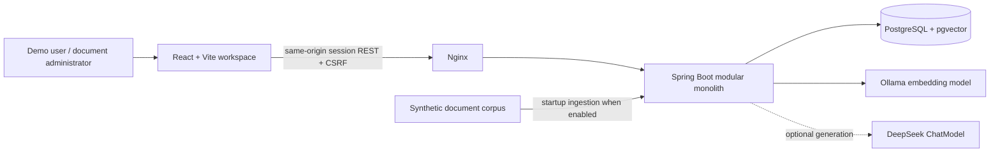
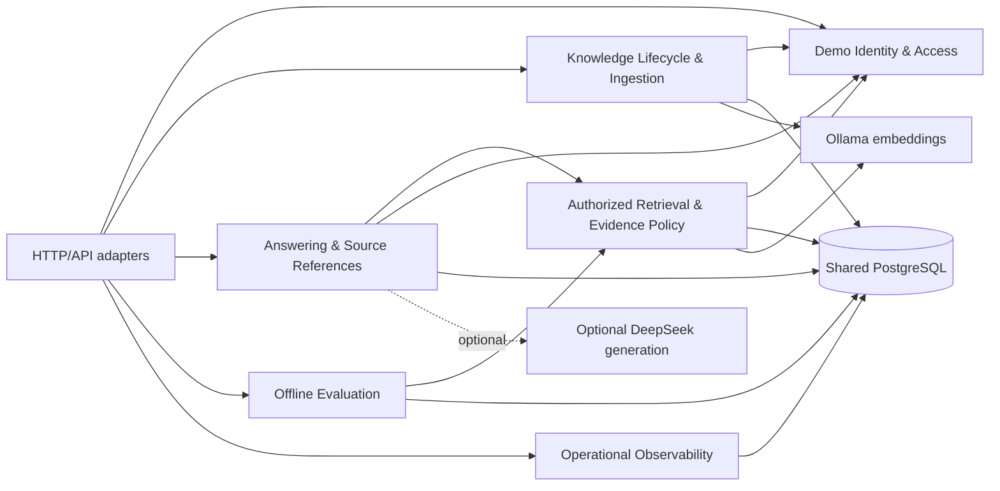
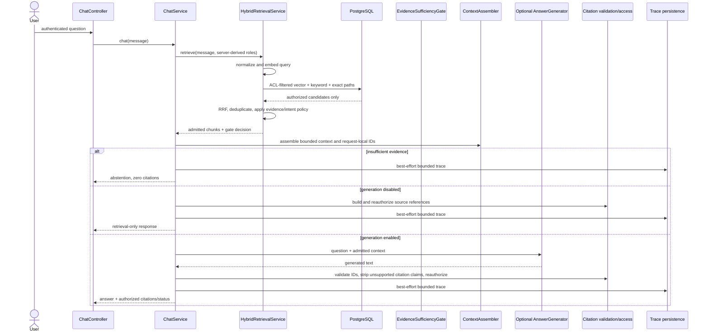

# DDD System Design

## Purpose and Reading Guide

This document explains the system as implemented in this repository using Domain-Driven Design (DDD) concepts. It is an analysis and design description, not a claim that the code follows strict tactical DDD. The backend is a capability-oriented Spring modular monolith whose packages provide useful candidate bounded contexts. Application services and concrete JDBC repositories currently carry most workflow and persistence responsibilities; formal domain layers, aggregate roots, and repository interfaces are not consistently present.

The system is an educational portfolio MVP for secure, evidence-grounded retrieval over a small synthetic document corpus. It is not a production-ready SaaS product. `docs/architecture.md` remains the approved architecture and source of truth for supported scope. This document describes the implementation and calls out material differences where they matter.

## Domain and Business Goal

The core problem is to help an authenticated user find useful answers in enterprise knowledge without allowing unauthorized material into retrieval results, model context, citations, or source previews. A second core capability is keeping indexed knowledge fresh while avoiding an interval in which a failed reindex replaces a working version. Deterministic evaluation makes retrieval, access control, freshness, citation-ID handling, and abstention behavior inspectable without relying on paid model judgments.

The system therefore has two closely related core domains:

- **Knowledge lifecycle:** curate logical documents, control their access, create indexed versions, and activate a complete version atomically.
- **Authorized evidence answering:** retrieve only currently authorized evidence, decide deterministically whether it is sufficient, optionally generate a response, and expose only reauthorized source references.

Offline evaluation and bounded observability support these domains. Demo identity, HTTP transport, PostgreSQL, embeddings, and chat-provider integration are supporting capabilities.

## System Context and Runtime Containers



The local Compose topology runs PostgreSQL/pgvector, Ollama, a one-shot embedding-model initialization service, the Spring backend, and the React static application served by Nginx. Nginx proxies `/api/` and `/actuator/` to the backend; only the frontend port is published by Compose. The backend uses PostgreSQL both as relational system of record and vector store. Ollama provides embeddings for ingestion and queries. Chat generation is optional: Compose defaults `CHAT_MODEL_PROVIDER=none`, while the standalone `application.yml` default is `deepseek`.

The frontend presents chat/source inspection, knowledge management, and evaluation workspaces. It is a client of the backend, not an authority for identity, roles, document status, or permissions. `frontend/src/api.ts` sends same-origin cookie requests and CSRF tokens for mutations. Key runtime configuration and deployment details are in `compose.yaml`, `backend/src/main/resources/application.yml`, `frontend/nginx.conf`, and `README.md`.

## Bounded Contexts and Context Map

The following are analytical bounded contexts inferred from existing package responsibilities. They are not separate deployables and do not imply that every context has its own domain model or persistence boundary.



| Context | Responsibility and implementation | Relationships |
|---|---|---|
| **Demo Identity & Access** | Resolves the fixed Alice/Bob/Carol demo identities into server-controlled retrieval roles and a separate `documentAdmin` capability; creates session authentication. Main code: `security/DemoIdentityService`, `DemoAuthenticationService`, `CurrentIdentity`, `SecurityConfiguration`. | Provides the authenticated principal and access scope consumed by document, retrieval, citation, evaluation, and trace operations. It is deliberately not a general enterprise identity context. |
| **Knowledge Lifecycle & Ingestion** | Validates uploads, parses Markdown/text/extractable PDFs, chunks and embeds content, reserves versions, persists chunks, changes metadata/permissions, and activates or fails versions. Main code: `document/ingestion/DocumentIngestionService`, `DocumentVersionRepository`, `DocumentManagementRepository`; parsers and chunking under `document/parsing` and `document/chunking`. | Uses identity capability checks at the API boundary, Ollama for vectors, and PostgreSQL for documents, versions, jobs, permissions, chunks, and embeddings. |
| **Authorized Retrieval & Evidence Policy** | Runs vector, full-text, and exact-identifier retrieval under SQL ACL/status/version predicates; fuses ranks and makes a deterministic evidence-sufficiency decision. Main code: `retrieval/HybridRetrievalService`, `HybridRetrievalRepository`, `ReciprocalRankFusion`, `EvidenceSufficiencyGate`, `RetrievalIntentPolicy`. | Consumes a server-derived role scope and the active knowledge index. Supplies authorized ranked evidence to answering and evaluation. |
| **Answering & Source References** | Orchestrates chat, bounded context assembly, optional generation, citation-ID validation, source authorization, and response construction. Main code: `generation/ChatService`, `AnswerGenerator`; `citation/ContextAssembler`, `CitationResponseBuilder`, `CitationAccessValidator`, `SourceRepository`. | Uses retrieval output and identity scope. An external chat model receives only evidence admitted by retrieval and the evidence gate. Source reads reauthorize against current access and version state. |
| **Offline Evaluation** | Loads a checked-in scenario dataset, executes retrieval/gate scenarios, computes metrics and diagnostics, runs an isolated embedding-prefix shadow experiment, and persists run results. Main code: `evaluation/EvaluationService`, `EvaluationScenarioEvaluator`, `EvaluationMetricsCalculator`, `PrefixShadowEvaluator`, `EvaluationRunRepository`. | Uses the same hybrid retrieval and evidence gate as runtime chat, with fixed test role scopes. Evaluation is admin-triggered and does not call the chat provider or judge model. |
| **Operational Observability** | Persists bounded chat trace records, exposes owner/admin trace reads, deletes records by retention, and records bounded Micrometer metrics. Main code: `observability/RagTrace`, `RagTraceRepository`, `TraceController`, `TraceRetentionJob`, `RagMetrics`. | Receives chat-request metadata from answering; evaluation updates bounded metrics but does not create chat traces. It is not an audit-grade event store and intentionally excludes raw query and source text. |
| **HTTP/API adapters** | Maps REST requests/responses, multipart files, exceptions, and session operations. Main code: `api/*Controller`, with evaluation and trace controllers in their feature packages. | Translates transport input to application operations. Some current controllers directly invoke concrete repositories, which is a known layering weakness described below. |

All contexts are deployed in one process and share one PostgreSQL database. The database is the transactional coordination boundary for version activation and the query-time ACL boundary for retrieval. Context communication is direct Java invocation, not messaging; there is no event bus or distributed job queue.

## Ubiquitous Language

| Term | Meaning in this system |
|---|---|
| **Logical document** | Stable document identity, keyed by `documents.id`; its identity remains stable as content versions change. |
| **Document version** | A content snapshot with a monotonically increasing per-document version number, hash, source metadata, embedding identity/dimension, indexing status, and chunks. |
| **Current version** | The version referenced by `documents.current_version_id` and eligible for retrieval when the document and version are active. |
| **Ingestion job** | A persisted record of indexing progress and a bounded failure detail for a document version. Current work is synchronous in the request path despite persisted job status. |
| **Allowed role / ACL** | A role name stored in `document_permissions` and matched to the authenticated server-side identity in SQL. It is not a department field supplied by the browser. |
| **Document administrator** | Separate demo capability available to Carol for document-management and evaluation operations; it does not add retrieval roles. |
| **Candidate** | A database-returned chunk eligible under the SQL access, document-status, and active-version predicates for a particular request scope. |
| **Fused candidate** | An authorized retrieval candidate ranked after vector, keyword, and exact-identifier lists are merged by Reciprocal Rank Fusion. |
| **Evidence gate** | Deterministic policy that returns either sufficient evidence chunks or an abstention reason. It is not a semantic entailment or factuality guarantee. |
| **Citation ID** | Request-local label such as `S1` assigned only to evidence included in the model context. It points to a source; it does not prove a generated claim. |
| **Trace** | Bounded operational metadata for one chat request, including query hash, counts, durations, model/provider, status, and gate outcome; not a full stage-span trace. |
| **Evaluation scenario** | Versioned fixture describing query, demo scope, expected/forbidden documents, freshness expectations, and expected gate outcome. |

## Domain Model and Aggregate Analysis

### Knowledge Lifecycle

The most important conceptual aggregate is **LogicalDocument**. A DDD model would make it the consistency root for metadata, current-version selection, document status, ACL roles, and the version lifecycle. Its invariant is that retrieval sees no more than one current active version and that permission changes apply consistently to all chunks of the logical document.

The implementation spreads that conceptual aggregate across `documents`, `document_versions`, `document_permissions`, `document_chunks`, and `ingestion_jobs`. `DocumentVersionRepository` performs transactional state changes with SQL and row/advisory locks. There is no in-memory `LogicalDocument` aggregate enforcing transitions. The schema provides foreign keys and uniqueness constraints for version numbers and chunk positions, while application transactions coordinate active-version state.

Conceptual entities and value objects:

- **LogicalDocument** (entity/root): stable ID, title, department, classification, document status, current version, and allowed roles.
- **DocumentVersion** (entity): ID, logical document ID, version number, SHA-256 hash, source filename, effective time, indexing status, embedding model ID, and dimensions.
- **IngestionJob** (entity): job ID, document/version references, status, safe error detail, and timestamps.
- **DocumentChunk** (version child/value): stable chunk identifier, ordinal, text, heading path, optional page, embedding, and full-text vector.
- **DocumentMetadata**, **ValidatedUpload**, **VersionReservation**, **IngestionRequest**, **IngestionResult**, and **ParsedDocument** (value-like records): immutable values used across ingestion steps.

In code, records such as `DocumentMetadata`, `ValidatedUpload`, and `DocumentChunk` are explicit, but the document/version/job concepts are largely represented by SQL rows and repository methods. Statuses and classifications are mostly persisted as strings constrained by SQL checks rather than expressed as domain enums and transition methods.

### Authorized Answering

The query-answering flow is better understood as a domain process/policy pipeline than as one aggregate. Its state is request-local and should not be persisted as a long-lived entity except for the bounded trace record.

- **Authenticated identity** is a value/scope resolved by `CurrentIdentity` from Spring Security's server-side principal.
- **RetrievalCandidate**, **RankedChunk**, and **RetrievalResult** are immutable result values, not entities.
- **EvidenceSufficiencyGate.Decision** carries the policy result, admitted chunks, reason, and diagnostics.
- **AssembledContext**, **CitationEvidence**, **Citation**, and **ChatResponse** are request/response values. Citation IDs are local to the supplied context.
- `ChatService` is the application orchestrator; the retrieval, evidence, context, and citation collaborators contain distinct policies and transformations.

Authorization is not a prompt instruction or model responsibility. Candidate eligibility is decided by parameterized database queries before RRF, then citation and source resolution recheck the current authorization/version state.

### Evaluation and Observability

An **EvaluationRun** is a persisted analytical record with dataset version, model/embedding identity, retrieval configuration, run status, summary metrics, and scenario results. The scenario and results are immutable values during the run. `EvaluationService` coordinates execution; `EvaluationRunRepository` persists it. The dataset is versioned JSONL (`evals/dataset.jsonl`), currently version `2026-10-p1-v5`, with 63 scenarios.

A **RagTrace** is a bounded operational record, not a domain event or full audit trail. The application stores query hash rather than raw query text, along with bounded counts/durations, provider/model, response mode, gate result, citation count, and status/error category. Trace persistence is best-effort on chat. Owner/admin authorization is applied on reads, and scheduled cleanup defaults to 30 days.

## Application Workflows

### Upload, Reindex, and Atomic Activation

```mermaid
sequenceDiagram
    actor Admin
    participant API as DocumentController
    participant App as DocumentIngestionService
    participant DB as PostgreSQL
    participant Parser as Parser + Chunker
    participant Embed as Ollama

    Admin->>API: upload / reindex + metadata + allowed roles
    API->>API: require documentAdmin; map request
    API->>App: ingest(request)
    App->>App: validate type, size, content, metadata; hash content
    App->>DB: reserve document/version under transaction lock
    DB-->>App: duplicate result or INDEXING reservation
    alt new or failed version
        App->>Parser: parse and chunk
        Parser-->>App: parsed sections and chunks
        App->>Embed: embed chunk text
        Embed-->>App: vectors
        App->>DB: transactionally persist chunks and activate version
        DB-->>App: committed activation
    else identical active content
        App-->>API: reuse result; apply metadata/ACL if changed
    end
    App-->>API: ingestion result
    API-->>Admin: version/job result
```

The implemented workflow in `DocumentIngestionService` validates input, reserves or reuses a version, parses and chunks non-duplicate content, embeds it, then calls `DocumentVersionRepository.activate`. The repository obtains an advisory transaction lock keyed by logical document ID when reserving, and locks the document row while activating. Activation persists chunks, supersedes the former active version, activates the new version, updates the current-version pointer and document metadata/ACL, and marks the job successful in one transaction. A failure marks the pending version/job failed; the prior current version remains active. Identical current content avoids embedding/version creation while metadata and ACL changes are applied transactionally. Inactive documents require explicit restoration.

This is a synchronous request workflow with persisted job status, not asynchronous distributed ingestion. The current supported formats are Markdown, plain text, and PDFs with extractable text. OCR is out of scope. The vector dimension is fixed at 768 by schema and configuration.

### Chat, Retrieval, and Citation Resolution



`HybridRetrievalService` normalizes a nonblank query (maximum 2,000 characters), embeds it, and requests vector, PostgreSQL full-text, and extracted exact-identifier candidates. `HybridRetrievalRepository` applies the same role, enabled-document, and active-version predicates in SQL on each path. `ReciprocalRankFusion` combines ranks without comparing raw scores and deduplicates by chunk identity. `EvidenceSufficiencyGate` then filters admitted context.

The current gate is more specific than a simple vector-plus-keyword threshold. It admits a permitted exact identifier match, or requires the same candidate to meet minimum vector similarity, minimum keyword score, and adaptive lexical coverage (0.30/0.35/0.40 based on meaningful query-term count). `RetrievalIntentPolicy` can reject sensitive-value requests, unsupported future/historical/specialized requests, multi-identifier comparisons, and requests requiring a role scope the user lacks. This policy is deterministic and shared by chat and offline evaluation. It is calibrated to the synthetic English corpus, not a general semantic correctness guarantee.

`ContextAssembler` preserves ranking, escapes angle-bracket delimiters in source text, labels sources as untrusted, assigns IDs only to included chunks, and enforces a 12,000-character default budget. It is character-bounded, not tokenizer-aware. Generation can be disabled; in that mode the system returns retrieval-only output. Generated citation IDs must refer to supplied evidence, and citation access is reauthorized before source metadata is returned. `CITATIONS_PRESENT` means authorized source IDs resolved; it does not mean claims were entailed or fact-checked. Unsafe/invalid results fall back to a safe response.

### Offline Evaluation

`EvaluationService` loads and validates the versioned JSONL dataset, executes the scenarios with server-defined fixed role scopes through `HybridRetrievalService`, computes metrics, and persists the run and scenario diagnostics. The same evidence gate is used by runtime and evaluation. The evaluation path does not invoke DeepSeek or a judge model. The optional prefix-shadow experiment embeds authorized current chunks in memory using `search_document:` and queries using `search_query:`; those vectors are not persisted, do not replace the active index, and do not affect runtime chat.

The suite measures retrieval (Recall@5/MRR), ACL leakage, freshness, citation-ID validator behavior, and evidence-gate outcomes. It does not evaluate generated answer correctness, claim entailment, or model abstention accuracy. Historical measurements in README and evaluation design docs are repository documentation, not results produced by this analysis.

## Policies and Invariants

### Identity and Access Control

- The Spring Security principal is the identity authority. The browser cannot grant roles by submitting role, department, or user ID fields.
- Demo login accepts fixed known identities and issues a server session. It is an identity selector, not password authentication or SSO. Unsafe session-cookie requests require CSRF protection.
- Alice maps to `ENGINEERING` and `PUBLIC`; Bob to `HR` and `PUBLIC`; Carol to `SECURITY_ADMIN` and `PUBLIC`. Carol's document-admin capability is separate from those retrieval roles.
- Vector, keyword, exact-identifier, and direct source SQL constrain role permissions, document status, and current/active version before protected rows leave the persistence query.
- Citation/source resolution reauthorizes against current permission and active-version state. Document listing/version metadata is role-filtered for ordinary users. Trace reads are owner/admin scoped. Evaluation and document mutation require the explicit admin capability.
- Revocation and disable/delete behavior take effect on subsequent SQL queries; chunks may be retained for history and are not physically purged by disable or soft delete.

These are application/database-query controls, not PostgreSQL Row-Level Security, production identity, or a complete production security boundary.

### Version and Failure Semantics

- A logical document has a stable ID; updating requires that ID and creates/reuses a version rather than silently creating a second logical document.
- Pending content is unavailable to retrieval until all chunks and embeddings are ready and activation commits.
- Activation updates chunks, version statuses, current pointer, metadata, ACL, and job status transactionally.
- A processing/embedding failure does not replace the prior active version; failed content remains unavailable until a retry succeeds.
- Advisory and row locks serialize initial reservation and activation per logical document. Database uniqueness constraints protect version numbers and chunk positions.
- Identical active content avoids unnecessary embedding/version work while permitting transactional metadata/ACL updates. An inactive logical document must be explicitly restored before reindexing.

### Data Handling and Model Boundaries

- Source text is untrusted data and is not an instruction authority.
- Only SQL-authorized, current chunks may enter RRF, evidence decisions, context assembly, generation, citations, or source preview.
- Routine traces persist a query hash and bounded operational fields, not raw query text or full source content. Trace persistence is best-effort for chat availability.
- Metrics are intended to use bounded labels; user IDs, document IDs, and query text are not appropriate metric dimensions.
- The active embedding index uses `nomic-embed-text` at 768 dimensions. Changing model/dimension requires a controlled reindex and must not mix incompatible vectors in the active index.
- Retrieval thresholds, lexical heuristics, prompt instructions, and citation checks do not prove semantic correctness or guarantee prompt-injection immunity.

## Persistence Model

PostgreSQL is the shared source of truth and vector store. Flyway migrations define the schema under `backend/src/main/resources/db/migration`.

| Table | Responsibility |
|---|---|
| `documents` | Stable logical identity, title/department/classification, status, current-version pointer, timestamps. |
| `document_versions` | Per-document sequence, content hash, source filename/effective time, indexing status, embedding model/dimension. |
| `document_chunks` | Version-scoped text/heading/page metadata, 768-dimensional vector, generated English `tsvector`, stable chunk position. |
| `document_permissions` | Role permissions applied consistently at the logical-document level. |
| `ingestion_jobs` | Version indexing status and bounded error detail/timestamps. |
| `evaluation_runs` | Dataset/model/configuration and run-level metrics/status. |
| `evaluation_scenario_results` | Per-scenario retrieval, freshness, gate, citation-ID, and diagnostic values. |
| `rag_traces` | Query hash and bounded chat operational metadata. |

SQL constraints enforce foreign keys, valid status/classification values, positive version/dimension values, unique `(document_id, version_number)`, unique `(document_version_id, chunk_index)`, and one indexing job per logical document. The document content-hash index is an index, not a unique constraint; reuse is decided by repository logic. Active-version coordination is transactional application logic rather than a dedicated database constraint guaranteeing at most one active row in all possible writes. The schema's vector dimension check is 768, matching the current MVP model.

Direct JDBC is deliberate for retrieval because the ACL predicates must remain explicit and reviewable in SQL. Repositories are concrete Spring/JDBC classes; domain-facing repository interfaces and separate persistence adapters are not consistently used.

## Code Organization and Dependency Boundaries

Backend packages under `backend/src/main/java/com/acme/rag` group capabilities: `security`, `document`, `retrieval`, `generation`, `citation`, `evaluation`, `observability`, and `api`. The intended dependency direction is transport to application orchestration, then domain policies and persistence/provider adapters. There are architecture tests in `backend/src/test/java/com/acme/rag/architecture/ArchitectureRulesTest.java` covering cycles and some transport-to-persistence dependencies.

The actual dependency structure is less strict:

- `DocumentController` injects `DocumentManagementRepository` and calls it for list/version/disable/delete/restore operations.
- `SourceController` and `TraceController` also reach concrete persistence components directly for simple read paths.
- Services such as `DocumentIngestionService`, `HybridRetrievalService`, `ChatService`, and `EvaluationService` coordinate workflows but also depend on concrete implementation collaborators.
- A single shared schema spans the contexts; there is no separate context-owned database or published integration contract.

These choices are pragmatic for a small modular monolith, but mean the code should be described as DDD-informed/capability-modular rather than strict hexagonal DDD. The existing architecture rules reduce some coupling but do not establish complete domain/infrastructure isolation.

## Technology and Deployment Decisions

- **Modular monolith:** one Spring MVC backend keeps transactional version activation and authorization query paths straightforward; the current scale does not justify distributed services or queues.
- **PostgreSQL + pgvector:** one relational/vector system of record, parameterized exact cosine search, PostgreSQL full text, and explicit SQL ACLs. Approximate indexes and separate search/vector systems are out of MVP scope.
- **Ollama embeddings:** local `nomic-embed-text` decouples indexing/query embeddings from optional answer generation.
- **Optional DeepSeek generation:** generation provider is independently configured; retrieval and offline evaluation remain useful without a paid chat key.
- **React/Vite + Nginx:** static UI and same-origin API proxy simplify browser cookie/CSRF behavior in the demo deployment.
- **Compose:** supports local reproducibility and persistent local database/model volumes; it is not production deployment guidance.
- **Deterministic offline evaluation:** fixtures and explicit labels make ACL, freshness, retrieval, and evidence-gate behavior repeatable without LLM judging.

No Kafka, Kubernetes, Redis, Elasticsearch/OpenSearch, separate vector database, OCR, document connectors, distributed indexing orchestration, live judge, or generated-answer benchmark is implemented.

## DDD Assessment and Evolution Opportunities

This assessment is descriptive, not a request to refactor the MVP. The current structure has meaningful domain vocabulary, cohesive capabilities, explicit policies, and important transactional invariants. It also has concrete opportunities if stronger DDD boundaries become a goal:

1. **Make lifecycle transitions explicit.** A cohesive document/version domain model could own allowed transitions and status values, while a persistence adapter implements the transaction. Today status strings and SQL statements collectively encode the lifecycle.
2. **Clarify application ports.** Use-case services could depend on narrow interfaces for document lifecycle, authorized retrieval, traces, and evaluations, keeping controllers from calling repository implementations directly. Keep ACL SQL in its persistence adapter and test it as a security boundary.
3. **Name authorization policy types.** Distinguish retrieval roles from management capability with explicit types/value objects rather than string sets and booleans at all boundaries. The current server-side behavior is already separated conceptually and should remain so.
4. **Protect cross-context contracts.** Define small immutable request/result contracts between retrieval, answering, and evaluation rather than exposing persistence-oriented records across capabilities.
5. **Keep evaluation and operational telemetry separate.** Evaluation runs are reproducible analytical artifacts; chat traces are bounded operational records. Neither should become a source-text logging path.

Any such evolution must preserve the approved invariants: identity is server-controlled; ACL filtering happens in SQL before fusion/context; source and trace reads independently authorize; version activation is atomic; the evidence gate is shared and deterministic; and MVP limitations remain explicit.

## Known Differences from the Approved Architecture Description

The following code-observed differences are relevant when interpreting `docs/architecture.md`:

- The evidence gate includes adaptive lexical coverage and additional intent/scope guards beyond a plain vector-plus-keyword threshold.
- Context size is a configurable character count (`max-context-characters`, 12,000 by default), not model-token-aware budgeting.
- Traces are bounded request records, not full stage spans; the UI's stage visualization does not establish that stage-level spans are persisted.
- `DocumentController`, `SourceController`, and `TraceController` have direct repository dependencies, so controller thinness/application-layer separation is incomplete.
- The content-hash index is not unique, and the active-version invariant is maintained by transactional repository behavior rather than a database constraint covering arbitrary writes.
- Trace rows contain no document references, so owner/admin scoping is currently the relevant read policy; document metadata reauthorization is not applicable to a trace with no referenced documents.
- Compose disables generation by default, while standalone backend configuration defaults the provider to DeepSeek. The overall feature is optional, but the defaults differ by runtime mode.
- The offline suite and reported metrics concern deterministic retrieval/security/gating, not generated-answer factual correctness or faithfulness.

No change to the approved modular-monolith direction is implied. These are implementation/detail differences and explicit layering limitations, not evidence that the broader security/versioning/evaluation design intent should be weakened.

## Scope and Limitations

This design supports a synthetic corpus and demo identities only. It does not provide production SSO, PostgreSQL RLS, production secret management, formal security review, DLP, audit-grade tamper protection, rate limiting, non-root container hardening, OCR, connectors, distributed jobs, generated-answer quality benchmarking, or universal semantic guarantees. See `docs/architecture.md`, `docs/security-design.md`, `docs/retrieval-design.md`, and `docs/evaluation-design.md` for detailed approved constraints and evaluation definitions.

## Key Code References

- `docs/architecture.md` - approved target architecture and MVP boundaries.
- `backend/src/main/java/com/acme/rag/security` - demo identity, session authentication, and current principal.
- `backend/src/main/java/com/acme/rag/document/ingestion` - validation, ingestion orchestration, version reservation/activation, and management persistence.
- `backend/src/main/java/com/acme/rag/retrieval` - SQL retrieval orchestration, RRF, evidence gate, and intent policy.
- `backend/src/main/java/com/acme/rag/generation/ChatService.java` - chat application workflow and best-effort trace persistence.
- `backend/src/main/java/com/acme/rag/citation` - context assembly, citation validation, source reads, and access rechecks.
- `backend/src/main/java/com/acme/rag/evaluation` - dataset execution, deterministic metrics, shadow experiment, and run persistence.
- `backend/src/main/java/com/acme/rag/observability` - traces, owner/admin reads, retention, and metrics.
- `backend/src/main/resources/db/migration` - relational/vector schema and subsequent evaluation/trace evolution.
- `compose.yaml`, `backend/src/main/resources/application.yml`, and `frontend/nginx.conf` - local runtime topology and configuration.
- `backend/src/test/java/com/acme/rag/architecture/ArchitectureRulesTest.java` - architecture boundary tests.
